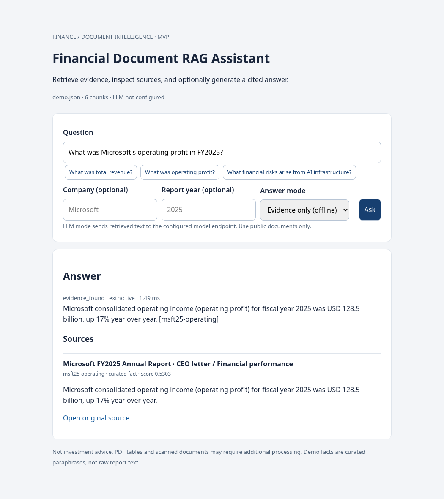
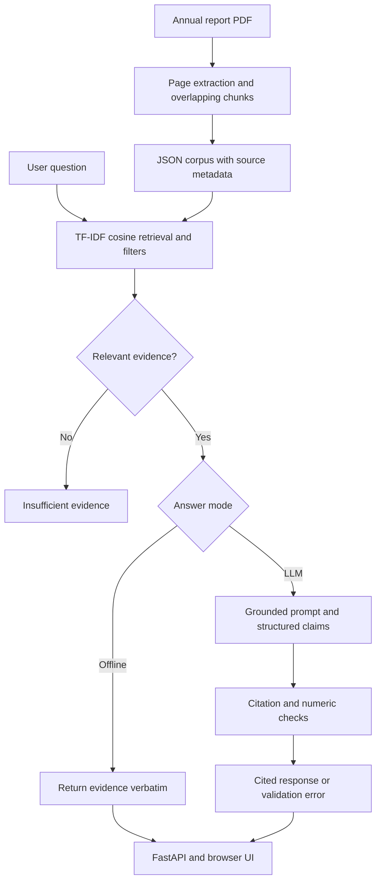

# Financial Document RAG Assistant

A finance-focused document QA prototype that retrieves evidence from annual reports and optionally synthesizes cited answers with an LLM. Designed to make financial claims inspectable rather than simply asking a chatbot to guess.

## What works today

- Extract text from text-based PDFs with pypdf; split into 180-word windows with 35-word overlap, keeping page-level provenance.
- Store document chunks as JSON with company, report year, source URL, page, and stable content-derived IDs. Exact-file re-ingestion is idempotent (same chunk settings).
- Rank chunks using TF-IDF sparse vectors and cosine similarity with finance-specific synonym normalization, metadata filters, and a simple relevance threshold.
- Serve source-backed evidence via a FastAPI REST API, browser UI, and CLI. No model or API key needed for evidence-only mode.
- Optional LLM synthesis through an OpenAI-compatible chat-completions endpoint. Claims must cite retrieved chunk IDs; a numeric presence check rejects some unsupported numbers. This is a guardrail, not proof of semantic correctness.
- Run automated unit/API tests and a small retrieval evaluation. Includes Dockerfile and GitHub Actions workflow.

## Demo



Screenshot captured from the actual UI using a FastAPI TestClient bridge because browser networking was restricted in the development environment. The HTTP API was also exercised independently with Uvicorn and curl.

## Architecture



## Quick start (macOS / Linux)

Python 3.11–3.13 recommended. From the repository directory:

```bash
python3 -m venv .venv
source .venv/bin/activate
python -m pip install -r requirements-dev.txt
python -m pytest -q
python -m app.evaluate
python -m uvicorn app.main:app --host 127.0.0.1 --port 8000
```

Open <http://127.0.0.1:8000> for the browser UI or <http://127.0.0.1:8000/docs> for interactive API documentation.

In another terminal (activate the virtual environment if using CLI):

```bash
python -m app.cli ask "What was Microsoft's operating profit in FY2025?" --k 1
curl -s http://127.0.0.1:8000/ask \
  -H 'Content-Type: application/json' \
  -d '{"question":"What financial risk arises from AI infrastructure?","company":"Microsoft","fiscal_year":2025,"k":1}'
```

### Demo questions

| Question | Expected evidence |
|---|---|
| What was total revenue? | USD 281.7 billion |
| What was operating profit? | USD 128.5 billion |
| What financial risk arises from AI infrastructure? | Higher operating costs and potential margin pressure |
| What is the CEO's favorite pizza topping? | Insufficient evidence |

The included `data/demo.json` contains six **curated, paraphrased facts** based on real Microsoft FY2025 disclosures. The source URLs and report sections are included. It is not a full downloaded annual report and the facts are not verbatim quotes. See [data provenance](data/SOURCES.md). This small corpus enables a reproducible offline demo, not a production benchmark.

## Index a real annual report PDF

The full annual report PDF is not bundled. Download it from the official [Microsoft FY2025 annual report download center](https://www.microsoft.com/investor/reports/ar25/download-center/index.html), or download the [official Form 10-K PDF](https://microsoft.gcs-web.com/static-files/9640e86d-a99f-4502-934d-1d3c883fa786). Save it as `data/microsoft-2025.pdf` (ignored by Git). Then:

```bash
python -m app.cli ingest data/microsoft-2025.pdf \
  --company Microsoft --year 2025 \
  --url 'https://microsoft.gcs-web.com/static-files/9640e86d-a99f-4502-934d-1d3c883fa786' \
  --out data/corpus.json
python -m app.cli ask 'What was operating income in 2025?' \
  --corpus data/corpus.json --company Microsoft --year 2025 --k 3
CORPUS_PATH=data/corpus.json python -m uvicorn app.main:app --port 8000
```

Use the URL that matches the actual file downloaded; the example uses the Form 10-K. Stop the previous server before restarting. Ingesting a second report into the same JSON file appends new chunks. PDF page numbers refer to the 1-based PDF page index, not necessarily the printed page number. On PDFs, the returned evidence is extracted text rather than a curated fact. Ingestion was tested on a synthetic two-page PDF; full-report behavior must still be verified on a real downloaded PDF.

## Optional generative RAG mode

The default is **extractive evidence retrieval**, not LLM generation. Enable the optional LLM connector to complete the retrieve-and-generate path. For example, install [Ollama](https://ollama.com/download) on your Mac, start the app/server, and run:

```bash
ollama pull qwen2.5:3b
export LLM_BASE_URL=http://localhost:11434/v1
export LLM_MODEL=qwen2.5:3b
python -m app.cli ask 'What was operating profit?' --mode llm --k 1
```

For browser use, restart Uvicorn from the terminal with those variables and select **LLM synthesis**. A hosted OpenAI-compatible endpoint can instead be configured with `LLM_BASE_URL`, `LLM_MODEL`, and `LLM_API_KEY` (never commit keys). Use a model that supports JSON-mode chat completions. No silent fallback occurs if generation fails. Only use public or explicitly authorized documents; LLM mode sends retrieved chunks to the configured endpoint.

**Verification status:** the generation request/response and citation/number validation were tested with a mocked HTTP response; no live LLM was available in the development environment. The Ollama configuration is an integration example, not a claimed live test.

## Tests and evaluation

```bash
python -m pytest -q
python -m app.evaluate
```

The committed [evaluation output](docs/evaluation-results.json) records an actual local run: 6 answerable questions plus 1 out-of-scope question on the six-fact demo corpus. Hit@1 and Hit@3 measure whether the expected source appears in the top 1 or 3 results, respectively. All 7 smoke checks passed in that run. This hand-authored tiny set is not representative of full reports; latency and scores are not production performance claims. Tests cover PDF extraction, page metadata, deduplication, retrieval, API validation, abstention, and mocked LLM validation.

## Docker (optional)

```bash
docker build -t financial-rag .
docker run --rm -p 127.0.0.1:8000:8000 financial-rag
```

Docker and GitHub Actions configurations are provided; no image build or remote CI run is claimed yet.

## Limitations and next steps

- Sparse TF-IDF retrieval is a transparent baseline, not a dense embedding model or hybrid search. Company/report-year filtering is explicit; a question mentioning a year is not a guarantee of matching the correct reporting period. The current score threshold is heuristic and cannot guarantee abstention.
- Layout-aware PDF extraction can lose table structure, units, and headers. No OCR, XBRL parser, numeric calculations, or robust financial table extraction. Verify figures against the actual report.
- Citation ID and numeric presence checks cannot validate entailment, currency, sign, reporting period, or completeness. The LLM can still make errors. Add independent human-reviewed evaluations before serious use.
- Next: dense embeddings + hybrid search and reranking; structured tables; larger held-out evaluation; LangGraph/MCP tool integration; Databricks/MLflow; authenticated deployment and monitoring. None of these are implemented in v0.1.
- Local prototype only: no user authentication, enterprise security controls, production deployment, or financial advice.

## Repository structure

```text
app/                 # ingestion, retrieval, optional generation, API, CLI, UI
 data/               # demo corpus, source references, evaluation questions
 tests/              # automated tests
 docs/               # actual evaluation results and interview notes
 .github/workflows/  # CI configuration
 Dockerfile          # container configuration
```
